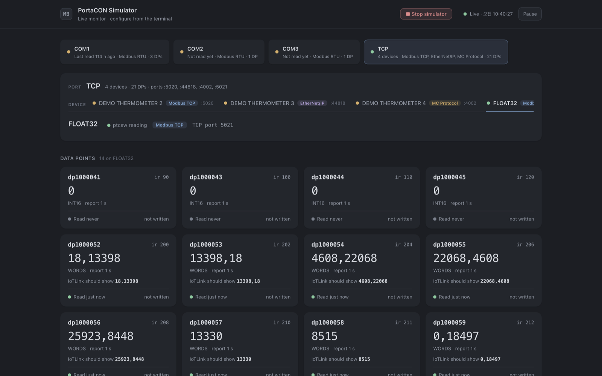
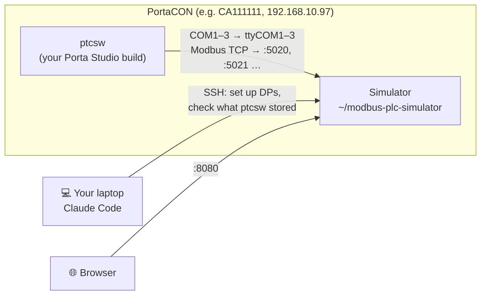

<div align="center">

# PortaCON Simulator

**Test a Porta Studio project on a PortaCON without the real devices.**<br>
The simulator plays your Modbus devices, ptcsw reads them like real ones, and Claude Code sets it up and checks the values.




</div>

## How it fits together



## 1. Set up (once, on your laptop)

macOS, Linux or WSL. Claude Code needs a paid Claude plan.

```bash
curl -fsSL https://claude.ai/install.sh | bash   # install Claude Code
ssh-copy-id portacon@<ip>                        # log in without a password from now on
git clone https://github.com/ajun-jo/portacon-modbus-simulator.git
cd portacon-modbus-simulator
./remote.sh portacon@<ip> install                # copies the simulator, starts the monitor, restarts both after a reboot
claude
```

## 2. Tell Claude what to simulate

Paste something like this, **one line per DP**:

```text
PortaCON <ip>, COM1 (or Modbus TCP), slave 1.
dp160: input register 200, FLOAT32, 1000 ms, read FC04, send 0.125
dp163: holding register 220, INT16, 1000 ms, read FC03 / write FC06, send 12345
```

Claude sets up the simulator and tells you what to enter in Porta Studio. It can also step values over time
(*"605 for 30 s, then 609, …"*), send raw register words for byte-order tests, delay replies, or play a dead device.

## 3. Set up Porta Studio

| Device | Where | What to enter |
|---|---|---|
| **Modbus RTU** | 프로필 → COM1 설정 → 포트 경로 | `/home/portacon/modbus-plc-simulator/ttyCOM1` (COM2 → `ttyCOM2`, …) |
| **Modbus TCP** | 배포 → device → IP 주소 / 포트 | `<ip>` and the port Claude gives you (5020, 5021, …) |

> [!WARNING]
> **Check 포트 경로 after every deploy.** It has reset to `/dev/ttyAMA2` before, and then every RTU read times out.
> It must have no spaces.

> [!IMPORTANT]
> **Register Data Type and Endianness must match what you told Claude.** A FLOAT32 read as INT16 comes out as
> nonsense, and Big / Little (word order) swaps the two halves of a 32-bit value.

> [!NOTE]
> Modbus TCP can't use port 502 here: ports below 1024 need root, and the simulator never uses sudo.

## 4. Check

Build and deploy, then ask Claude to **"check the values"**. It reads what ptcsw stored and gives you a table of
DP × value sent × value stored, with ✅ / ❌ and the reason for each ❌.

Watch it live at **[portacon-simulator.local:8080](http://portacon-simulator.local:8080)** (or `http://<ip>:8080`):

- one tab per port (COM1–3, TCP), and a device picker inside each tab
- every DP's current value and when ptcsw last read it
- a live log of every read and write
- **Stop simulator / Start simulator** at the top right. Stop takes every simulated device offline at once.

To update: `git pull`, then run the `install` line again.

<details>
<summary><b>What's in the repo</b></summary>

| File | What it is |
|---|---|
| `modbus_plc_sim.py` | The simulator: Modbus RTU / ASCII / TCP, one process per port, many slaves per port |
| `run.sh` | Start, stop, reset and status on the PortaCON (`./run.sh status`) |
| `remote.sh` | The same from your laptop over SSH (`./remote.sh portacon@<ip> status`) |
| `modbus_client.py` | Show, set and read values (`python3 modbus_client.py show com1`) |
| `webui.py` | The web monitor on port 8080 |
| `studio_to_init.py`, `xlsx_to_init.py` | Make simulator files from a Studio project or an address sheet |
| `CLAUDE.md` | Instructions Claude Code follows in this repo |
| `mc_legacy/` | An older MC protocol (Mitsubishi) simulator, not installed by `install` |

On CA111111 an MC protocol and an EtherNet/IP simulator also run; the monitor shows them under the TCP tab.

</details>
